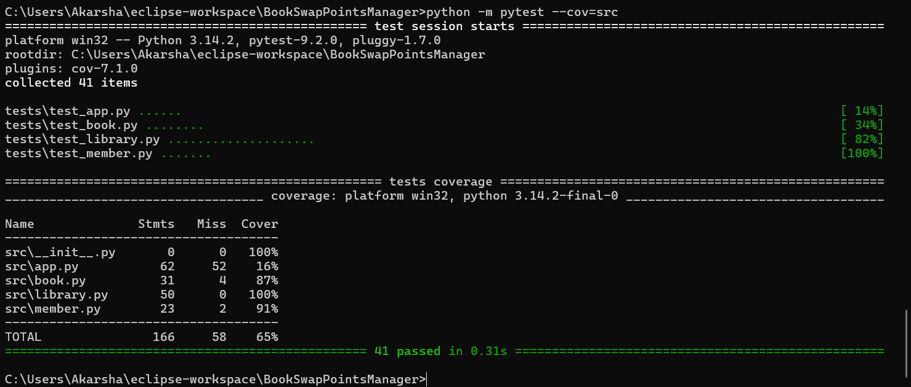

# Book Swap Points Manager

A small console application where members donate books to earn points and redeem points for other donated books — built to learn unit testing with `pytest` in the Eclipse IDE (PyDev).

## 🚀 How to Run

    # Run the application
    python src/app.py

    # Run the test suite
    python -m pytest

    # Check test coverage
    python -m pytest --cov=src

## 🛠️ What it Covers
- AAA-pattern (Arrange-Act-Assert) unit tests
- Parametrised test cases and fixtures
- Testing error paths with `pytest.raises`
- Test coverage measurement via `pytest-cov`
- Test-Driven Development (TDD) workflow

## 📸 Proof of Work

*41 passing tests with 100% coverage on the core rules module*

---
**Built by [Akarsha Sirisena](https://github.com/ashisirisena442)**
